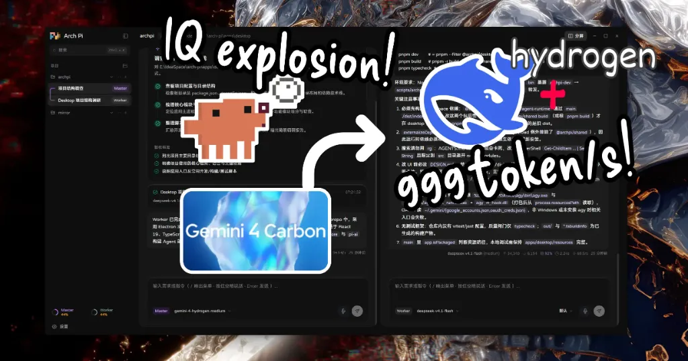
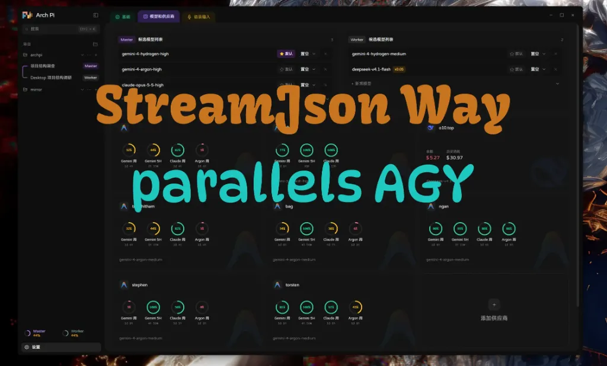
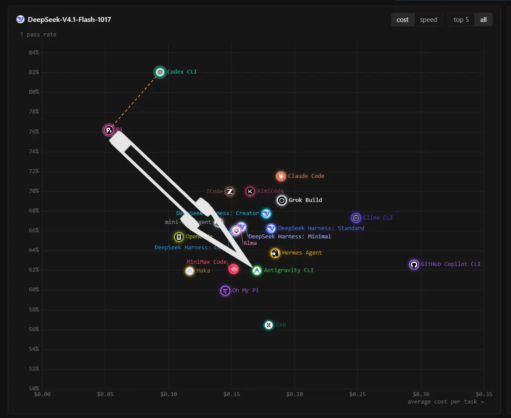

<div align="center">

<br />


<h1>Arch Pi</h1>

<p>
  <strong>Orchestrator → Worker Workspace + Multi-Agy Parallelism × Arbitrary Relay Routing</strong>

  <br />

  Built on <a href="https://github.com/badlogic/pi-mono"><code>Pi</code></a> Agent.
</p>

<p>
  <a href="./README.md">简体中文</a> &nbsp;·&nbsp; <a href="./README.en.md">English</a> &nbsp;·&nbsp; <a href="./DESIGN.md">Design Spec</a>
</p>

<br />



High-cost <strong>Master</strong> autonomously plans -> reviews; relay <strong>Worker</strong> picks up execution

</div>

<br />

## Solutions

1. **Antigravity multi-account parallelism without switching dropouts** — StreamJson lets the official `agy` CLI seamlessly continue sessions concurrently across accounts
2. **Native Orchestrator architecture for peak cost-performance** — Expensive quota-limited models understand complex requirements and review results; ultra-high-value Hydrogen / DeepSeek or any low-cost relay model you have does the heavy lifting

---

## Multi-Account Agy Parallelism × Relay Model Pool

<div align="center">
  <br />
  
  <br />
  <sub><strong>Role-split Master / Worker candidate pools &amp; balance tracking</strong><br/><code>x0.05</code> relay routing, live quotas across multiple personal Antigravity accounts, and real-time Sub2API balance tracking</sub>
</div>

---

## Pi Agent Foundation



- **Top-tier Agent Harness foundation**
- **Detailed telemetry** — Every turn tracks **TTFT**, **token/s**, and **cache hit**
- **Zero filesystem clutter** — Everything stays cleanly inside `~/.archpi/`

---

## Design Restraint Spec

Arch Pi neutral-dark design specification: [`DESIGN.md`](./DESIGN.md)

---

## File Structure

```text
arch-pi/
├── apps/
│   └── desktop/                  # Electron 35 + React 19 + Tailwind CSS 4 + Zustand 5
│       ├── resources/            # Per-process Agy credential isolation hook (Windows) & app icons
│       ├── src/main/             # Main-process IPC, Agy 5h/7d quota & Sub2API balance polling
│       ├── src/preload/          # Context-isolated window.archpi bridge
│       └── src/renderer/         # Linked split workspace, Kanban board, quota rings & settings
├── packages/
│   ├── agent-runtime/            # Unified runtime bridging pi-agent-core & GeminiAgyAdapter
│   │   └── src/
│   │       ├── runtime.ts        # Dual-engine turns, SSE normalization, plan dispatch & ~/.archpi store
│   │       ├── tools.ts          # Workspace-sandboxed Master / Worker / Reviewer toolsets
│   │       └── providers/        # Provider registry & GeminiAgyAdapter (stream-json)
│   └── shared/                   # Cross-process shared contracts (AliveWindow, PlanSpec, TaskCard, etc.)
├── scripts/
│   └── archpi-dev.mjs            # Dev launcher (archpi-dev)
└── DESIGN.md                     # Mandatory frontend UI visual specification
```

---

## Getting Started

### Prerequisites
- **Node.js** `>= 20.0.0`
- **pnpm** `>= 9.0.0`
- *(Optional, for Antigravity windows)* Local `agy` CLI installed and authorized

### Run Locally

```bash
git clone https://github.com/parallized/arch-pi.git
cd arch-pi
pnpm install
pnpm dev
```

### Typecheck & Build

```bash
pnpm typecheck
pnpm build
```

---

## Contributing

Early days — feel free to jump in and contribute anything.

---
